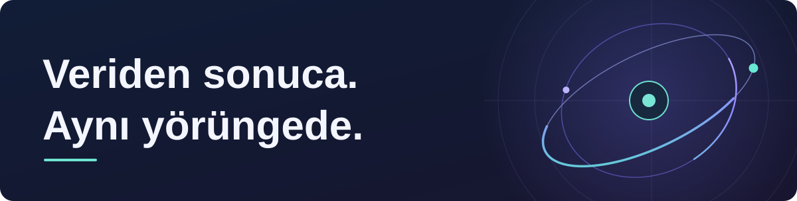
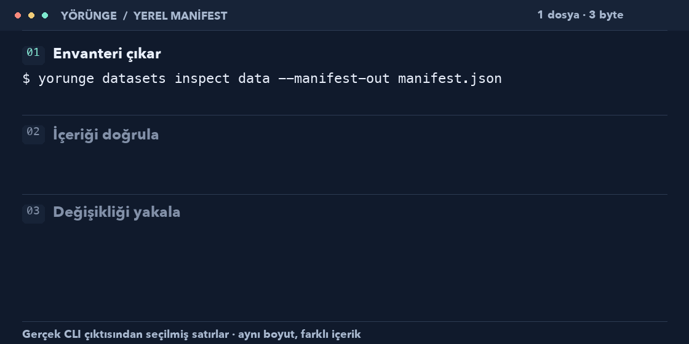

# Yörünge



**EVREN iş akışları için ortak bir CLI ve Python API.**

Veri setleri, modeller, çıkarım, eğitim, kaynaklar ve sonuçlar arasında daha az araç değiştirerek çalışmak için geliştiriliyor. Hafif istemci, ortak komutlar, otomasyona uygun çıktılar.

[**Denemeye başla**](#çalışan-başlangıç) · [Kullanım rehberi](docs/reference/local-workflows.md) · [Yol haritası](docs/roadmap/README.md) · [Katkı yap](#birlikte-geliştirelim)

**Geliştirme sürümü · 5 Kasım 2026.** Henüz yayımlanmış paket yok; kurulum kaynaktan. [Güncel teslim durumu →](docs/roadmap/current.md)

## Genel bakış

| Alan | Bugün ve sırada |
|---|---|
| **Hesap ve proje** | **Var:** yerel profil/doctor ve EVREN hizmetlerinden salt okuma gözlemleri. Doğrulanmış uzak kimlik/yetki çözümlemesi ayrı iş. |
| **Veri setleri** | **Var:** yerel envanter, manifest ve içerik doğrulama; farklı içerikli dosyalar için onaylı private yükleme ve aynı işi salt okumayla inceleme ([kabul durumu](docs/roadmap/current.md)). **Planlandı:** etkili resume, model ağırlığı indirme ve veri sürümü referansı ([P02-3 planı](docs/roadmap/p02-3-delivery-plan.md); onay bekleyen kararlar); dataset baytı indirme sağlayıcı erişimine bağlı. |
| **Modeller ve çıkarım** | **Planlandı:** model kataloğu, LLM metin/akış, embedding, rerank ve görsel çıkarım. |
| **Eğitim ve araçlar** | **Var:** yerel plan hazırlığı. **Planlandı:** yönetilen EVREN eğitimi, varsayılan ForgeLM ve seçilebilir araç adaptörleri. |
| **Kaynaklar ve sonuçlar** | **Var:** yerel iş geçmişi. **Planlandı:** GPU/kota görünürlüğü, uzak iş izleme ve sonuç toplama. |

CLI ve Python aynı çekirdeğe bağlanır; **JSON / NDJSON** otomasyonu destekler. Plan hazırlamak işi başlatmaz; salt okuma gözlemleri kimlik veya yetki kanıtı üretmez. [Yetenek matrisi](docs/capability-matrix.md) · [Ürün kapsamı](docs/product-scope.md)

## Çalışan başlangıç

**Gerekenler:** Python 3.11+, `uv 0.11.2`, macOS veya Linux. Depoyu klonlayıp bu sayfayla aynı dalı seçtikten sonra, kök dizinde:

```sh
uv sync --frozen --python 3.11
.venv/bin/yorunge --help
```

`uv` kurulu değilse [kurulum adımları](CONTRIBUTING.md#geliştirme-ve-doğrulama). Anahtar veya hesap gerektirmeyen iki başlangıç:

```sh
.venv/bin/yorunge context show --config examples/profile.toml
.venv/bin/yorunge train plan --config examples/profile.toml --recipe examples/training.yaml
```

İkinci komut **draft plan** üretir; model indirmez veya eğitim başlatmaz. [Python örnekleri ve diğer akışlar →](docs/reference/local-workflows.md)

<details>
<summary>Yerel veri manifestini dene — GIF ve çalışan örnek</summary>

Klasörün manifestini çıkar, bütün içerikleri yeniden hash’leyerek doğrula. Gösterim gerçek CLI çıktısından hazırlanmıştır.

<picture>
  <source media="(max-width: 600px)" srcset=".github/assets/dataset-demo-compact.svg">
  <source media="(prefers-reduced-motion: reduce)" srcset=".github/assets/dataset-demo.svg">
  
</picture>

```sh
mkdir -p .local
demo_dir=$(mktemp -d "$PWD/.local/yorunge-demo.XXXXXX")
mkdir "$demo_dir/data"
printf 'abc' > "$demo_dir/data/hello.txt"
.venv/bin/yorunge datasets inspect "$demo_dir/data" --manifest-out "$demo_dir/manifest.json"
.venv/bin/yorunge datasets verify "$demo_dir/data" --manifest "$demo_dir/manifest.json"
```

**Beklenen sonuç:** `Dosyalar manifestle eşleşiyor.` Manifest root dışında tutulur; mevcut hedefin üzerine yazılmaz. [Durağan gösterim](.github/assets/dataset-demo.svg) · [Değişiklik örneği ve sınırlar](docs/reference/local-workflows.md#yerel-dosya-manifesti)

</details>

## Birlikte geliştirelim

Hata raporları, küçük kullanım örnekleri ve doküman iyileştirmeleriyle başlayabilirsin. Büyük değişiklikleri önce bir issue’da konuşalım; geliştirme PR’larının hedefi `development`.

[**Katkı rehberi**](CONTRIBUTING.md) · [Hata / öneri paylaş](https://github.com/HodeTech/Yorunge/issues) · [Mimariyi incele](docs/architecture/README.md) · [Tüm belgeler](docs/README.md)

---

[MIT](LICENSE) · [Güvenlik bildirimi](SECURITY.md) · [Topluluk ilkeleri](CODE_OF_CONDUCT.md)

HodeTech’in bağımsız yardımcı araç projesidir. EVREN adı uyumluluk hedefini belirtir; resmî platform ürünü veya onayı olduğu iddia edilmez.
