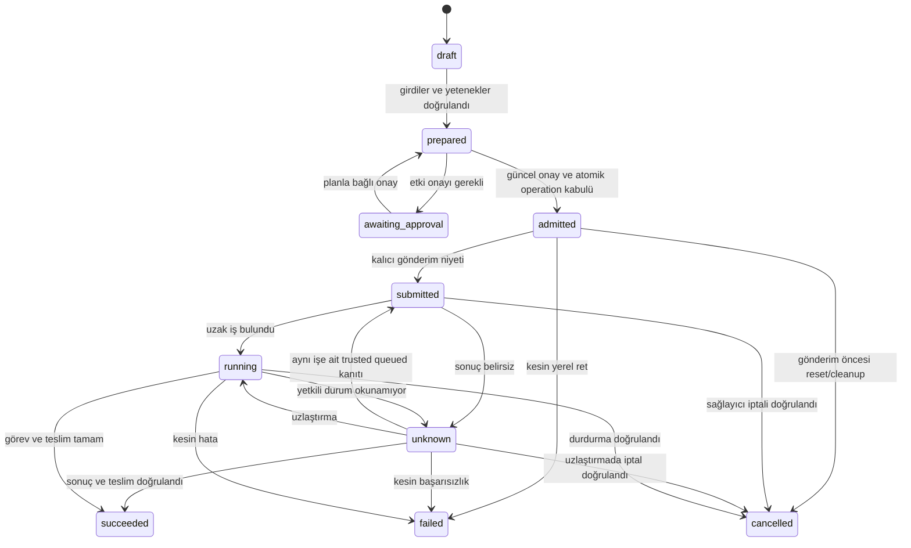

# Plan ve çalıştırma modeli

**Durum:** Benimsenmiş tasarım. **Güncellendi:** 2026-10-30.

Offline v1 stateless draft üretir. P01-3 ayrı kalıcı execution hazırlığı, descriptor input bağı, güncel validation ve onay/yönetim çekirdeğini ekler. Ürün producer'ında araç/uzak auth/tam girdi kapanışı doğrulanmadığı için public plan draft ve onaylanamaz kalır; prepared/onay pozitifliği yalnız test portuyla kanıtlanır. Şema/seçim ve digest doğrulaması, aşağıdaki tam execution bağlarının yerine geçmez. [Uygulanan CLI sınırı](../reference/cli-contract.md#uygulanan-alt-küme).

P01-3'ün ayrı execution biçimi/geçerlilik/onay ve yeni state tüketicilerinin bakım davranışı [Accepted ADR-0014](../decisions/0014-execution-plan-validity-and-approval.md) içindedir. Kullanıcı onayı 2026-10-27 tarihinde alındı; uygulama/test ve iki review turu adımları [kabul kaydındadır](../research/p01-3-implementation-validation.md). Operation/lease/trusted recovery çekirdeği P01-4 içinde testlidir; public run/EVREN adaptörü P02/P03 tasarımı olarak kalır.

P01-4'ün somut operation kimliği/gönderim/ownership sınırı [Accepted ADR-0016](../decisions/0016-operation-admission-and-ownership.md) ile benimsendi; adım 1–3 ve ikişer fresh review kabulü tamamlandı; public jobs adım 4 ve son kaynak paket kabulüyle PR #10 development'a alındı; [merge/CI kaydı](../research/p01-4-implementation-validation.md#development-merge-kapanışı) kanoniktir. Aşağıdaki diyagram kavramsal uçtan uca akıştır: uygulanan immutable planın draft/prepared durumu ile ayrı operation durumu aynı DB satırının geçişleri değildir. Tam görev deadline/delivery politikası da uygulanmış plan v2'nin 300 s geçerliliği veya mevcut 30 s validation çağrı bütçesiyle eş tutulmaz.

## Planın içerdiği bağlar

Plan; görev türü, veri/model sürümü ve hash'leri, seçilen araç/sürüm, ortam, etkiler, maliyet tahmininin kaynağı/tarihi, parametre eşleme raporu ve deadline politikasını içerir. Kullanılan her hizmet için aşağıdaki bağlar da kanonik temsile ve onay digest'ine dahildir:

| Bağ | Anlam |
|---|---|
| `service_id`, `service_origin`, `api_base_path` | Platform/LLM gibi hizmet kimliği, normalleştirilmiş scheme/host/etkin port ve API kök yolu |
| `account_id`, `project_id` | İşlemin hedeflediği hesap ve gerekiyorsa proje |
| `credential_id`, `credential_revision` | Kullanılan yetkilendirme bilgisinin sır olmayan opak kimliği ve değişimde yenilenen nesli |
| `authorization_scope` | İşlem için doğrulanmış izinler ve kaynak sınırları |

`credential_id` anahtarın kendisi, öneki/soneki veya ham hash'i değildir. Sağlayıcının sır olmayan anahtar kimliği/sürümü kullanılabilir; bunlar yoksa yerel sır yönetimi opak kimlik ve değişim nesli sağlar. Bir env/keychain referansının aynı kalması, değerinin değişmediğine kanıt değildir. Anahtar değişimi saptanamıyor veya gerekli yetki kapsamı doğrulanamıyorsa uzak yürütme için geçerli bağ kurulmuş sayılmaz. Salt yerel görevde kullanılmayan hizmet bağı gerekmez; eksik uzak bağları olan offline plan uzak yürütme onayı sağlamaz.

Plan sır değeri içermez. Bu bağların tamamı dahil kanonik temsilin digest'i ve şema sürümü onayla ilişkilendirilir.

Plan/capability/registry hedef eşlemesinin byte düzeyindeki ayrıntısı [credential binding v1](../reference/credential-binding-v1.md) olarak Accepted ADR-0012 ile benimsenmiştir. Etkin 443 portunun origin metninden çıkarılması ve eski offline Plan'ın değiştirilmeden karşılaştırılması orada tanımlanır; tasarım onayı ürün uygulaması veya kabul kanıtı yerine geçmez.

Araç seçimi ve tüm önemli girdiler plan hazırlığında çözülür. `run` sırasında sürüm/executable, hizmet origin'i/API kökü, hesap/proje, yetki kimliği/nesli/kapsamı veya veri değişmişse eski plan uygulanmaz; yeniden planlama ve etki politikasına göre yeni digest'e bağlı onay gerekir. Aynı profil adı bu kontrolün yerine geçmez. Uzak tahminin geçerlilik sınırı ve bilinmeyen maliyet açık kalır.

Bu operasyon modeli uzak sağlayıcının ham durumlarını silmez. Execution ve delivery alt durumları ayrı saklanır: örneğin eğitim tamam ama indirme bekliyor olabilir. `succeeded`, görev sözleşmesindeki teslim koşulu da sağlandığında kullanılır.

## Yan etki öncesi sıra

1. Profil, görev, araç, ortam ve planı doğrula; her hizmetin güncel hedef, hesap/proje ve yetki bağını onaylı digest'teki bağla karşılaştır. Kullanılacak sır bu doğrulanmış bağa ait olmalı; denetimden sonra profil/env yeniden çözülerek başka sır veya hedef seçilmez. Bağ değişmiş veya doğrulanamıyorsa yan etkiyi başlatma.
2. Etki/onay politikasını uygula; kullanıcıdan aynı geçerli plan için gereksiz tekrar onayı isteme.
3. Kalıcı operation/attempt ve gerekiyorsa bütçe rezervasyonunu işlemsel kaydet; yazılamıyorsa başlatma.
4. Sahiplik lease'i ve fencing token'ını doğrula; sağlayıcı destekliyorsa kayıtlı idempotency/correlation anahtarını kullan.
5. İsteği veya alt süreci başlat; ham kimliği ve sonucu kaydet.
6. Sonucu ve artefakt teslimini doğrula; rezervasyon/gerçek tüketimi uzlaştır.

Yerel lease veya idempotency kaydı, uzakta tam bir kez çalıştırma garantisi yaratmaz. Sağlayıcı desteği yoksa yanıt kaybı unknown kalır ve başka sahibin aynı işi yeniden göndermesi engellenir. Yakın zamanlı benzer model/veri işi kesin korelasyon kanıtı sayılmaz.

## İptal ve toparlanma

Yerel izlemeyi durdurmak uzak eğitimi durdurmaz. Planlanan `jobs stop` etkiyi önizler, sağlayıcının durdurma sonucunu bekler veya belirsizliği kaydeder. Kısmi dosya/çıktı kaydı korunur; tamamlanmış gibi adlandırılmaz. Sahiplik devrinde günlük ve plan okunamıyorsa yeni yürütüm başlamaz.

`submitted` veya `unknown` işlem, kayıtlı uzak kimlik/korelasyon üzerinden aynı işin sağlayıcı tarafından iptal edildiği doğrulanırsa `cancelled` olur. İptal isteğinin kabulü, timeout, yerel izleyicinin kapanması veya tek başına işin bulunamaması iptal kanıtı değildir; sonuç belirsizse `unknown` korunur. Ham sağlayıcı durumu ve doğrulama kaynağı işlem kaydına eklenir.

Salt okunur istek, dosya PUT’u ve kaynak oluşturan POST için replay güvenliği ayrı kanıt ister. Güncel [ADR-0017](../decisions/0017-bounded-http-transport.md) yalnız açık read-only GET/HEAD retry’sine izin verir; PUT’un sağlayıcıda idempotent olması bugünkü taşıma politikasını kendiliğinden değiştirmez. Çok aşamalı aktarımın aşama/replay ve iş/istek deadline modeli [P02 karar kapılarında](../roadmap/phase-02-data-and-inference.md#p01den-devralınan-sınırlar-ve-karar-kapıları) hazırlanır. [Durum saklama](data-and-state.md), [CLI sonucu](../reference/cli-contract.md).
