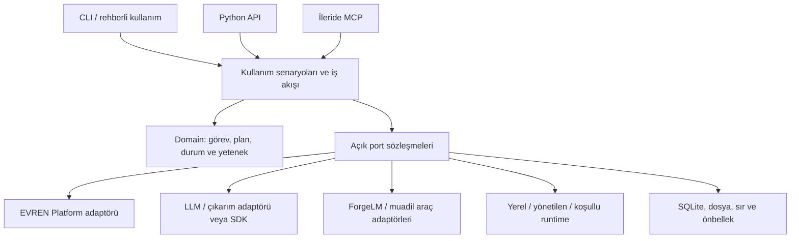

# Mimari genel görünüm

**Durum:** Benimsenmiş tasarım. **Tarih:** 2026-10-27.

Oklar kullanım bağımlılığını gösterir; portun somut adaptör seçimi dış composition katmanında yapılır. Domain somut adaptöre bağımlı değildir. İlk uygulama tek Python dağıtımıdır; kullanıcı akışını bölmek için mikroservis gerekmez.

## Ortak çekirdek

Çekirdek görev/plan çözümleme, kimlik ve yetenek bağlama, yan etki politikası, kalıcı işlem durumu ve sonuç modelini taşır. Alan modülleri veri seti, çıkarım, eğitim gibi kullanım senaryolarını sahiplenir. Çekirdek model eğitimi veya bütün sağlayıcı parametrelerini kendisi uygulamaz.

İlk gerekli portlar: Platform/LLM hizmet erişimi, araç sağlayıcısı, execution backend'i, state/artifact store ve sır erişimi. Saat/deadline test edilebilir bağımlılıktır. Genel bir plugin sistemi, event bus servisi veya uzak kuyruğun kendiliğinden eklenmesi hedef değildir.

## Kullanım senaryosu sınırı

CLI parse/render yapar; bir veri seti yükleme kuralını kendi içinde tekrar yazmaz. Python ve MCP aynı sonuç/hata/plan kurallarına uyar. “Ajan kullanıyor” diye onay veya bütçe politikası gevşetilmez. Aynı şekilde terminal paneli kapalıyken veri doğrulama ortadan kalkmaz.

EVREN Platform, gateway ve haricî araçlar ayrı adaptörlerdir. Uygun SDK kullanılabilir; fakat ham SDK sonucu uygulamanın bütün katmanlarına yayılmaz. Araç seçimi sadece ilgili görevde çalışır; veri yükleme akışı ForgeLM import etmez.

## Basitlik ve performans

Tek komut için hafif başlangıç, lazy import ve gerekene kadar bağlantı açmama esastır. Açık sahipli session içinde sınırlı HTTP havuzu kullanılır; süreç genelinde auth/cookie taşıyan global client yoktur. [ADR-0017](../decisions/0017-bounded-http-transport.md) async kaynak/deadline sınırını belirler; sınırlı worker yalnız gerçek ihtiyaçta kullanılır. CPU/disk işleri gerektiğinde sınırlı işçiye taşınır; tüm dosyaları aynı anda hash'lemek optimizasyon varsayılmaz. Yerel durum tek işlem otoritesidir; uzak hizmetin gerçek iş durumu ayrıca uzlaştırılır.

Fiziksel kaynak yerleşimi [proje yapısında](../project-structure.md), kabul bütçeleri [performans standardında](../standards/performance.md) tanımlıdır.
