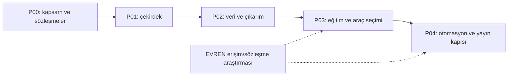

# Yol haritası

**Güncellendi:** 2026-10-27. Fazlar takvim vaadi değil, kabul kapılarıdır. İlk yerel planlama dilimi çalışıyor; uzak özellikler planlanıyor.

| Faz | Çıktı | Durum |
|---|---|---|
| [P00 — temel](phase-00-foundation.md) | Kapsam, standartlar, mimari ve sözleşme belgeleri | Tamamlandı — belge temeli |
| [P01 — çekirdek](phase-01-core.md) | Hafif CLI/API, context/capability, kalıcı işlem ve test altyapısı | Uygulanıyor — yerel alt küme doğrulandı |
| [P02 — veri ve çıkarım](phase-02-data-and-inference.md) | Veri yaşam döngüsü, katalog, LLM/çıkarım ve kaynak okuma | Planlandı |
| [P03 — eğitim ve araçlar](phase-03-training-and-tools.md) | Yönetilen eğitim, ForgeLM varsayılanı + muadil, sonuç toplama | Planlandı |
| [P04 — otomasyon/sağlamlaştırma](phase-04-automation-and-hardening.md) | MCP, ileri servisler, doğrulanmış runtime ve yayın hazırlığı | Planlandı / dış kapılı alanlar |

[Etkin durum](current.md), [açık karar/engeller](backlog.md), [özellik durumu](../capability-matrix.md) ayrı sorulara cevap verir. Performans ve kullanıcı kolaylığı tüm fazlarda kabul koşuludur; P04'e ertelenmez. EVREN runtime kapısı açık değilse yerel araç desteği bağımsız ilerleyebilir; runtime desteği yayımlanmış sayılmaz.
