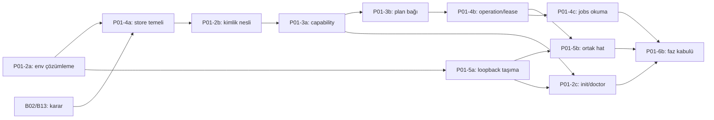

# P01 — Hafif çekirdek ve gerçek sözleşmeler

**Durum:** Uygulanıyor; yalnız offline alt küme doğrulandı. **Bağımlılık:** P00. **Yetenekler:** C01/C02/C12/C13. Bu belge iş sırasını, kartlar ayrıntılı kabulü taşır.

## Epikler ve gerçek durum

| ID | Sınır | Önkoşul | Kabul kanıtı / kalan | Durum |
|---|---|---|---|---|
| P01-1 | Paket, CLI, şema ve YAML seçimi; lock/build | P00 | [İlk dilim](../research/p01-core-validation.md), [PR #1](https://github.com/HodeTech/Yorunge/pull/1); HTTP seçimi P01-5a'ya taşındı | `verified` |
| P01-2 | Config/context ve hizmete bağlı secret erişimi | P01-1 | TOML/yerel context mevcut; çözümleme ve kimlik nesli eksik | `partial` |
| P01-3 | Kapsam/kanıt/tazelik bağlı capability ve execution planı | P01-2b, P01-4a | Seçim/offline draft mevcut; hesap cache'i ve yürütme geçerliliği eksik | `partial` |
| P01-4 | SQLite, migration, operation/attempt ve sahiplik | P01-1 | Kalıcı state henüz yok | `draft` |
| P01-5 | HTTP, ortak sonuç/hata, akış ve iptal | P01-2a | CLI/Python yerel zarf mevcut; taşıma/yürütüm eksik | `partial` |
| P01-6 | Kurulum, CI, performans ve faz kabulü | İlgili alt işler | Gerçek Ubuntu CI mevcut; gelecek alt işlerin kapıları eksik | `partial` |

P01-1'in eski HTTP adayı bu epikte açık iş olarak sayılmaz; ADR-0008'deki kapsam kararıyla gerçek taşıma seçimi P01-5a'dadır. `partial`, tamamlanan offline işi yeniden yapma veya bütün epik hazır demek değildir.

## Daraltılmış sıra

| ID | Tek teslim sınırı | Önkoşul | Kanıt / kapsam dışı | Durum |
|---|---|---|---|---|
| P01-2a | Açık istekle hizmete özel env secret çözümleme; yerel komutların sır okumaması | P01-1 | [Hazır kart](tasks/p01-2a-secret-resolution.md); HTTP, keychain, DB ve nesil kaydı yok | `ready` |
| P01-4a | Yerel store açma/migration ve kimlik kayıt temeli | P01-2a; B02/B13 kararları | Geçici gerçek DB'de migration, izin/bozuk kayıt ve süreç yeniden açma; tam operation/lease yok | `draft` |
| P01-2b | Opak credential kimliği/nesli ve hedef bağları | P01-2a, P01-4a | Aynı env adı altında değer değişince eski bağ geçersiz; ham secret/hash çıktı veya DB'de yok | `draft` |
| P01-2c | Yerel init/context yönetimi ve doctor yüzeyi | P01-2a, P01-3a, P01-5a | Config no-clobber/yedek, açık proje tercihi ve tipli tanılama; canlı hesap/proje keşfi P02-0b | `draft` |
| P01-3a | Kapsamlı capability kaydı ve cache/tazelik politikası | P01-2b, P01-4a | İki credential, hedef/proje/izin farkı, stale saat ve unknown/access ayrımı | `draft` |
| P01-3b | Offline draft'tan ayrı execution geçerliliği ve onay bağı | P01-3a | Saved seçim değişmez; değişmiş girdi/hedef/yetkiyle yürütüm reddi | `draft` |
| P01-4b | Operation/attempt, lease/fencing ve unknown uzlaştırma temeli | P01-4a, P01-3b | Çökme/kilit/lease devri ve ikinci yan etkiyi engelleme; gerçek EVREN yok | `draft` |
| P01-4c | Yerel jobs list/show ve kalıcı plan/sonuç sorgusu | P01-4b, P01-3b | Gerçek store'dan sınırlı tipli okuma; fixture seed ürünün sahte işi olmaz, uzak watch/stop P03'tedir | `draft` |
| P01-5a | HTTP/SDK seçimi ve ortak taşıma portu | P01-2a; B01/B03 incelemesi | Loopback: TLS/hedef/redirect/sır, tek retry/total deadline bütçesi; ücretli istek yok | `draft` |
| P01-5b | JSON/NDJSON, iptal ve tipli kullanım senaryosu hattı | P01-5a, P01-4b | Gerçek loopback/süreç sınırı, kesilen akış ve iptal ayrımı; fake yalnız fixture | `draft` |
| P01-6a | İlk offline geliştirici ve CI kurulumu | P01-1 | [Canlı CI/koruma kanıtı](../research/branch-workflow-validation.md) | `verified` |
| P01-6b | P01 kapanış akışı ve desteklenen ortam kaydı | P01-2c, P01-3b, P01-4c, P01-5b | Her kabulün kanıtı, kurulum/restart/hata/performans; paket yayını değil | `draft` |

P01-5a taşıma deneyi, state işinin tamamını beklemeden loopback üzerinde yapılabilir. Kimlik nesli için kalıcılık gerektiğinden P01-4a, P01-2b'den öncedir; “önce bütün kimlik, sonra DB” döngüsü kurulmaz. B02/B13 kararı alınmadan kalıcı credential biçimi icat edilmez. İlk başlayacak tek ürün paketi **P01-2a**; bu hazırlık çalışması onun implementasyonu değildir.

## Kapanışta beklenen akış

Mevcut teslim: context → sınırlı capability → seçim → şeması doğrulanmış **offline draft** → tipli planlama sonucu. Yürütme, dosya/model doğrulaması ve artefakt yoktur.

Faz sonunda: sentetik görev → sabit context/yetki bağları → capability/plan → kalıcı operation/attempt → yalnız fixture içinde gerçek loopback veya alt süreç → doğrulanmış tipli sonuç ve restart/unknown deneyi. Test double kullanıcıya açık eğitim başarısı olmaz. Gerçek EVREN ve ForgeLM/muadil adaptörleri P02/P03'tedir.

## Çıkış kapısı

Yardım/sürüm ağ, DB, keychain, model/araç keşfi ve ML import yapmaz. Uzak kimlik bağları doğrulanmadan execution yetkisi verilmez; kritik state yazılamıyorsa yan etki başlamaz. Config/recipe önceliği, native görev bağımsızlığı ve fallback yasağı korunur. CLI/Python sonuçları, desteklenen hata/çıkış kodu ve JSON/NDJSON saflığı contract testiyle kanıtlıdır. [Performans](../standards/performance.md) ve [test](../standards/testing.md) kapıları geçer.

Asgari Python hedefi ile gerçekten koşulan OS/Python matrisi ayrı kaydedilir. Genel plugin yükleyici, GUI, gerçek eğitim ve kullanıcı LLM serving bu faza girmez. P01-6b kartı hazır edilmeden faz tamamlandı yapılmaz.
