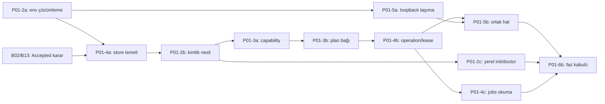

# P01 — Hafif çekirdek ve gerçek sözleşmeler

**Durum:** Uygulanıyor; offline çekirdek ve yerel kimlik/state alt kümesi doğrulandı; faz bütünü sürüyor. **Bağımlılık:** P00. **Yetenekler:** C01/C02/C12/C13. Bu belge iş sırasını, kartlar ayrıntılı kabulü taşır.

## Epikler ve gerçek durum

| ID | Sınır | Önkoşul | Kabul kanıtı / kalan | Durum |
|---|---|---|---|---|
| P01-1 | Paket, CLI, şema ve YAML seçimi; lock/build | P00 | [İlk dilim](../research/p01-core-validation.md), [PR #1](https://github.com/HodeTech/Yorunge/pull/1) ve [P01-1a kapanışı](tasks/p01-1a-core-acceptance-hardening.md); HTTP seçimi P01-5a'ya taşındı | `verified` |
| P01-2 | Config/context, hizmete bağlı secret, kimlik nesli ve yerel init/doctor | P01-1; B02/B13 kararları Accepted | [Tek PR teslim planı](p01-2-delivery-plan.md); dört alt kart verified; [PR #6](https://github.com/HodeTech/Yorunge/pull/6) development’a [merge c042383](https://github.com/HodeTech/Yorunge/commit/c042383178c051fa2ea9e895d5179e681f8450f1) ile alındı; review/CI/merge kanıtı [kayıtta](../research/p01-2-implementation-validation.md#development-merge-kapanışı) | `verified` |
| P01-3 | Kapsam/kanıt/tazelik bağlı capability ve execution planı | P01-2b, P01-4a | Seçim/offline draft mevcut; [paket planı](p01-3-delivery-plan.md), Accepted ADR-0013/0014; P01-3a/b verified; dört adım ve ikişer review tamamlandı, development PR kullanıcı incelemesi/CI kapısı | `in_review` |
| P01-4 | SQLite, migration, operation/attempt ve sahiplik | P01-1; alt işlerin kendi önkoşulları | P01-4a temeli PR #6 ile development’a alındı; operation/lease henüz yok | `partial` |
| P01-5 | HTTP, ortak sonuç/hata, akış ve iptal | P01-2a | CLI/Python yerel zarf mevcut; taşıma/yürütüm eksik | `partial` |
| P01-6 | Kurulum, CI, performans ve faz kabulü | İlgili alt işler | Gerçek Ubuntu CI mevcut; gelecek alt işlerin kapıları eksik | `partial` |

P01-1'in eski HTTP adayı bu epikte açık iş olarak sayılmaz; ADR-0008'deki kapsam kararıyla gerçek taşıma seçimi P01-5a'dadır. `partial`, tamamlanan offline işi yeniden yapma veya bütün epik hazır demek değildir.

## Daraltılmış sıra

| ID | Tek teslim sınırı | Önkoşul | Kanıt / kapsam dışı | Durum |
|---|---|---|---|---|
| P01-1a | Mevcut offline çekirdeğin parser/şema hata sınırı ve dağıtım kabulünü sağlamlaştırma | P01-1 | [Tamamlanan kart ve merge/CI kanıtı](tasks/p01-1a-core-acceptance-hardening.md); HTTP/state/secret çözümleme eklemez | `verified` |
| P01-2a | Açık istekle hizmete özel env secret çözümleme; yerel komutların sır okumaması | P01-1 | [Tamamlanan kart](tasks/p01-2a-secret-resolution.md); iki review turu ve gerçek kabul kanıtı | `verified` |
| P01-4a | Yerel store açma/migration ve kimlik kayıt temeli | P01-2a; B02/B13 kararları | [Tamamlanan kart](tasks/p01-4a-state-foundation.md); iki review turu ve gerçek kabul kanıtı | `verified` |
| P01-2b | Opak credential kimliği/nesli ve hedef bağları | P01-2a, P01-4a | [Tamamlanan kart](tasks/p01-2b-credential-identity.md); gözlem ve bakım ikişer review turuyla doğrulandı | `verified` |
| P01-2c | Yerel init/context yönetimi ve doctor yüzeyi | P01-2a, P01-4a, P01-2b | [Tamamlanan kart](tasks/p01-2c-local-context-management.md); iki review turu, yerel tanılama; HTTP/uzak keşif kapsam dışı | `verified` |
| P01-3a | Kapsamlı capability kaydı ve cache/tazelik politikası | P01-2b, P01-4a | [Kabul kartı](tasks/p01-3a-scoped-capability-cache.md); 929 test, iki review turu ve cache p95 157,082 ms | `verified` |
| P01-3b | Offline draft'tan ayrı execution geçerliliği ve onay bağı | P01-3a | [Kabul kartı](tasks/p01-3b-execution-plan-validity.md); 1.133 test, iki temiz kurulum ve kaynak bütçesi; adım 2/3/4 ikişer review ile tamamlandı | `verified` |
| P01-4b | Operation/attempt, lease/fencing ve unknown uzlaştırma temeli | P01-4a, P01-3b | Çökme/kilit/lease devri, ikinci yan etkiyi engelleme ve backup sonrası unknown kaybında restore reddi; gerçek EVREN yok | `draft` |
| P01-4c | Yerel jobs list/show ve kalıcı plan/sonuç sorgusu | P01-4b, P01-3b | Gerçek store'dan sınırlı tipli okuma; fixture seed ürünün sahte işi olmaz, uzak watch/stop P03'tedir | `draft` |
| P01-5a | HTTP/SDK seçimi ve ortak taşıma portu | P01-2a; B01/B03 incelemesi | Loopback: TLS/hedef/redirect/sır, tek retry/total deadline bütçesi; ücretli istek yok | `draft` |
| P01-5b | JSON/NDJSON, iptal ve tipli kullanım senaryosu hattı | P01-5a, P01-4b | Gerçek loopback/süreç sınırı, kesilen akış ve iptal ayrımı; fake yalnız fixture | `draft` |
| P01-6a | İlk offline geliştirici ve CI kurulumu | P01-1 | [Canlı CI/koruma kanıtı](../research/branch-workflow-validation.md) | `verified` |
| P01-6b | P01 kapanış akışı ve desteklenen ortam kaydı | P01-2c, P01-3b, P01-4c, P01-5b | Her kabulün kanıtı, kurulum/restart/hata/performans; paket yayını değil | `draft` |

P01-1a [PR #4](https://github.com/HodeTech/Yorunge/pull/4), P01-2 paketi [PR #6](https://github.com/HodeTech/Yorunge/pull/6) ile development'a alındı. B02/B13 kararları Accepted; P01-2a → P01-4a → P01-2b → P01-2c teslim sırası tamamlandı. [Kabul ve merge kaydı](../research/p01-2-implementation-validation.md#development-merge-kapanışı) kanoniktir. Aktif P01-3 hazırlığı [inceleme raporu](../research/p01-3-readiness-review.md), [tek PR planı](p01-3-delivery-plan.md) ve iki kartla daraltıldı; ADR'ler onaylandı, P01-3a/b yerel kabulü verified; epik development PR kullanıcı incelemesindedir. Yerel doctor teslim edildi; cache bu paket, HTTP ve uzak hesap keşfi ilgili sonraki işlerdir.

| Development PR paketi | Teslim edilecek alt işler |
|---|---|
| P01-2 PR'ı | P01-2a, P01-4a, P01-2b, P01-2c |
| P01-3 PR'ı | P01-3a, P01-3b |
| P01-4 PR'ı | P01-4b, P01-4c; P01-4a önceki pakette tamamlanmış olmalı |
| P01-5 PR'ı | P01-5a, P01-5b |
| P01-6 PR'ı | P01-6b; P01-6a ilk altyapısı zaten tamam |

Alt iş ayrı PR zorunluluğu değildir; [epik PR sözleşmesi](README.md#epik-başına-pr) geçerlidir. Teknik olarak bağımsız P01-5a deneyi yapılabilse de kullanıcının mevcut teslim tercihi bu paket sırasıdır.

## Kapanışta beklenen akış

Mevcut teslim: context → sınırlı capability → seçim → şeması doğrulanmış **offline draft** → tipli planlama sonucu. Yürütme, dosya/model doğrulaması ve artefakt yoktur.

Faz sonunda: sentetik görev → sabit context/yetki bağları → capability/plan → kalıcı operation/attempt → yalnız fixture içinde gerçek loopback veya alt süreç → doğrulanmış tipli sonuç ve restart/unknown deneyi. Test double kullanıcıya açık eğitim başarısı olmaz. Gerçek EVREN ve ForgeLM/muadil adaptörleri P02/P03'tedir.

## Çıkış kapısı

Yardım/sürüm ağ, DB, keychain, model/araç keşfi ve ML import yapmaz. Uzak kimlik bağları doğrulanmadan execution yetkisi verilmez; kritik state yazılamıyorsa yan etki başlamaz. Config/recipe önceliği, native görev bağımsızlığı ve fallback yasağı korunur. CLI/Python sonuçları, desteklenen hata/çıkış kodu ve JSON/NDJSON saflığı contract testiyle kanıtlıdır. [Performans](../standards/performance.md) ve [test](../standards/testing.md) kapıları geçer.

Asgari Python hedefi ile gerçekten koşulan OS/Python matrisi ayrı kaydedilir. Genel plugin yükleyici, GUI, gerçek eğitim ve kullanıcı LLM serving bu faza girmez. P01-6b kartı hazır edilmeden faz tamamlandı yapılmaz.
